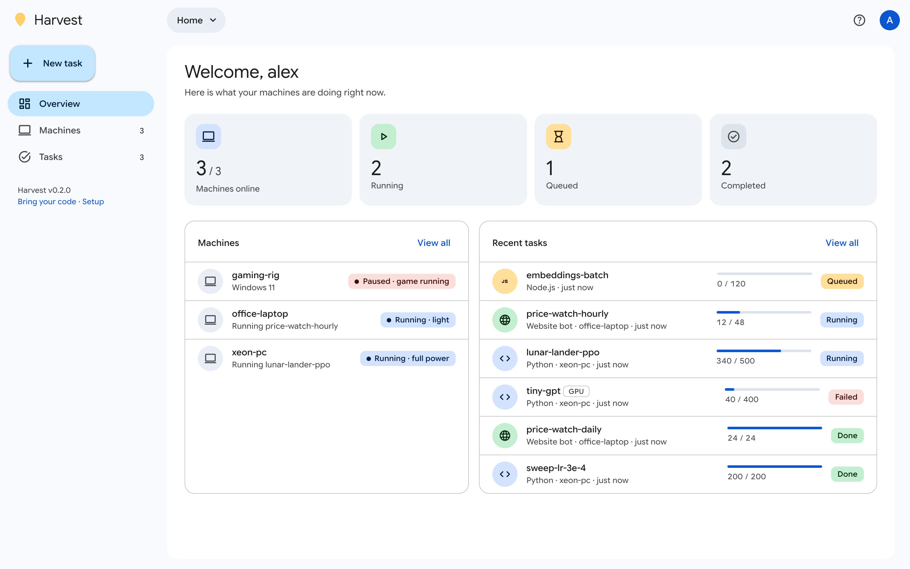
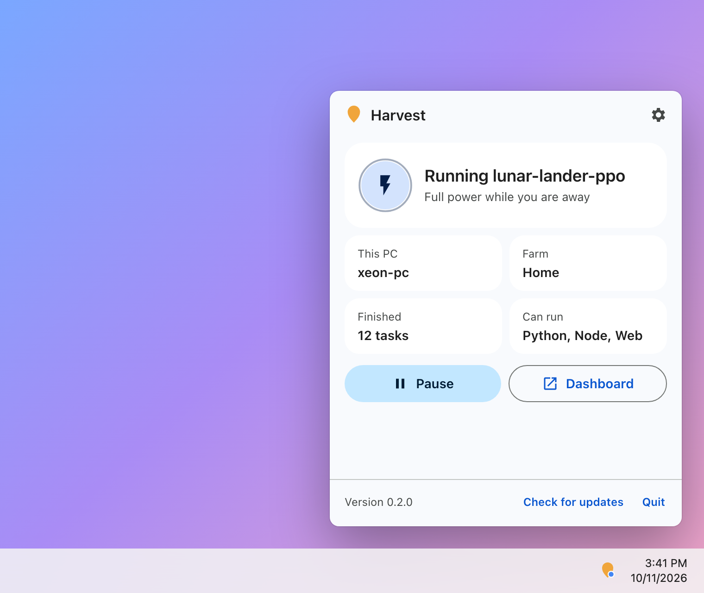
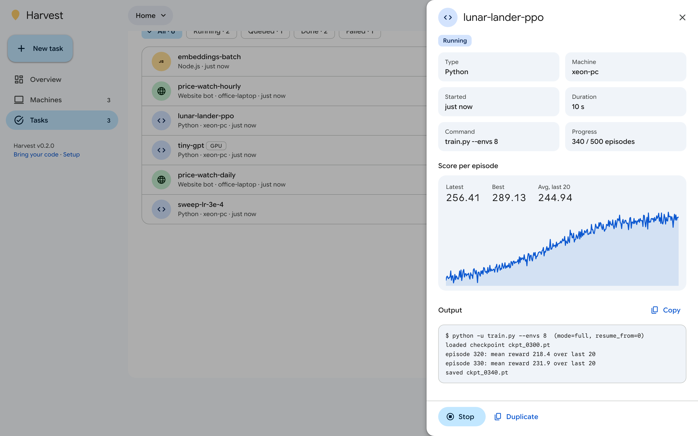
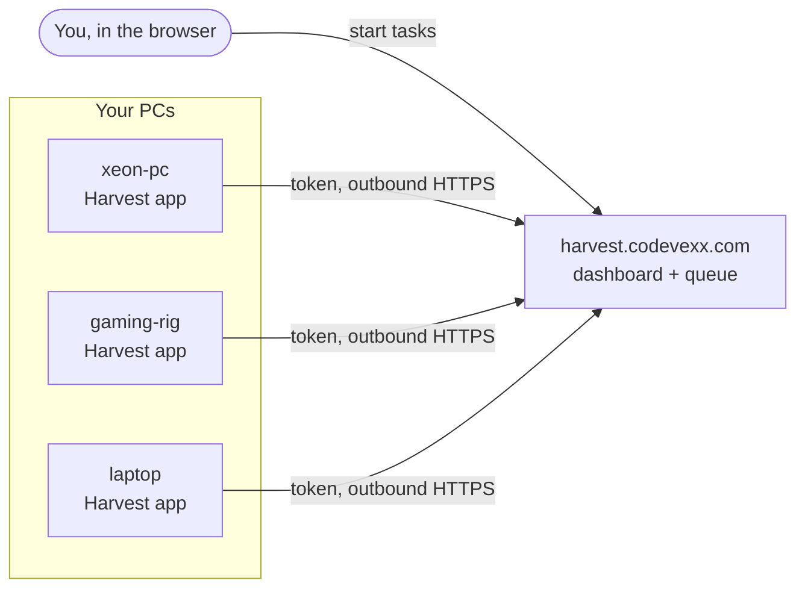

<div align="center">


# Harvest

**Put your idle PCs to work.**

Harvest runs your Python, Node.js and website-bot tasks on the computers you already own,<br>
while they sit idle, and steps aside the moment you start a game. Built for anything from data jobs<br>
to reinforcement learning, and usable by your AI assistant through an API.

[](https://github.com/codevexx/harvest/releases/latest)
[](https://github.com/codevexx/harvest/actions/workflows/build-windows.yml)


[](LICENSE)

[**Download for Windows**](https://github.com/codevexx/harvest/releases/latest/download/Harvest-Setup.exe) &nbsp;·&nbsp;
[Dashboard](https://harvest.codevexx.com/app) &nbsp;·&nbsp;
[Setup guide](https://harvest.codevexx.com/setup) &nbsp;·&nbsp;
[Bring your code](https://harvest.codevexx.com/compat)

<br>



</div>

## Why Harvest

You probably have a gaming PC, an old workstation or a laptop that sits idle most of the day. Harvest turns
them into one private compute farm you control from the browser:

- **Idle-aware.** Full power when nobody is at the keyboard, a gentle two-thread mode while you work.
- **Game-aware.** Launch a game (or anything fullscreen) and the task stops instantly, keeps its checkpoint,
  and resumes later.
- **Bring any code.** Upload a Python script, a whole Node.js project, or point a headless browser at a page.
- **Smart placement.** Each task goes to the best idle machine for it (GPU, RAM, threads, who is at the
  keyboard, who has been idle longest), or to every machine at once.
- **AI-ready.** Create an API key and your AI assistant can start, watch and collect tasks for you
  ([API guide](https://harvest.codevexx.com/api.txt)).
- **One dashboard.** Every machine, the queue and live score charts, on desktop or phone.

The service runs at [harvest.codevexx.com](https://harvest.codevexx.com). You never host a server or open a
port: each PC connects out to Harvest with a private token. This repository is the open-source part that runs
on your machines: the Windows app and the worker agent inside it.

## The Windows app



Harvest lives by the clock. Click the leaf and a panel opens above the taskbar, like the Wi-Fi or volume
panels, showing:

- what the PC is doing right now, and why
- a **Pause** button for when you need every core
- settings for start-with-Windows, games to always pause for, and website-task support
- **Run before anyone signs in**: starts with the PC, so a machine nobody logs into still works

It **updates itself** from this repository's releases, and checks every download against the SHA-256
published with it before installing.

### Install

1. Download **[Harvest-Setup.exe](https://github.com/codevexx/harvest/releases/latest/download/Harvest-Setup.exe)**
   and run it. No admin rights needed.
2. Sign in at [harvest.codevexx.com](https://harvest.codevexx.com/app) with Google, open **Machines**, choose
   **Connect a machine** and copy the token.
3. Click the Harvest icon by the clock, paste the token, press **Connect**.

For a PC nobody signs in to (a home server), tick **Keep working when no one is signed in** in the
installer, then connect it from any terminal on that PC:

```bat
start /wait "" "%LOCALAPPDATA%\Programs\Harvest\Harvest.exe" --connect YOUR_TOKEN --name server-pc
```

<br clear="right">

> [!NOTE]
> The installer is not code-signed yet, so Windows SmartScreen may show "Windows protected your PC".
> Choose **More info**, then **Run anyway**.

## What you can run

| Kind | How it runs |
|------|-------------|
| **Python** | `python <file> [args]` in its own task folder; packages from `requirements.txt` are installed once per PC |
| **Node.js** | `node <file> [args]`, after `npm install` if there is a `package.json` |
| **Website bot** | opens a URL in headless Chromium and runs your JavaScript inside the page |

Nothing to install by hand: if a PC has no Python or Node.js, the app downloads its own private copies
(and Playwright with Chromium for website bots), checks each against its published checksum and digital
signature, and keeps them inside `%LOCALAPPDATA%\Harvest\runtimes`. No admin rights, and a Python or Node
you installed yourself is used first and never modified.

Upload a single file or a whole folder (up to 50 MB). Nothing in your code has to change. Anything a task saves in its `outputs/` folder
(path in `HARVEST_OUTPUTS`) is zipped and can be downloaded from the dashboard when it finishes. Each
account has 100 MB of storage for uploads and outputs, kept for 30 days.
For a live chart and progress bar, print one JSON line per step:

```python
print(json.dumps({"progress": {"step": i, "value": loss, "total": n}}), flush=True)
```

Reinforcement learning code can report `{"episode": {"index": i, "reward": r}}` instead.

Website bots return their score instead:

```js
const items = document.querySelectorAll(".result");
harvest.log(`found ${items.length}`);
harvest.save("items.json", [...items].map(i => i.textContent));  // downloadable afterwards
return { reward: items.length };
```

The full contract, including resuming after a pause, is in the
[compatibility guide](https://harvest.codevexx.com/compat).

<p align="center"></p>

## How it works



Each agent decides every few seconds whether its machine is free:

| Mode | When | What happens |
|------|------|--------------|
| `full` | no keyboard or mouse input for a while | tasks run at full power |
| `light` | you are using the PC | two threads, below-normal priority |
| `paused` | a game or fullscreen app is in front | the task stops and is re-queued with its checkpoint |
| `held` | you pressed **Pause** in the app | no new tasks until you resume |

Your code and data run only on your machines. The service stores your account, the queue, task files you
upload, and the progress your tasks report.

## Run from source (macOS, Linux, Windows)

```bash
git clone https://github.com/codevexx/harvest
cd harvest
python -m venv .venv && source .venv/bin/activate   # Windows: .\.venv\Scripts\Activate.ps1
pip install -r requirements.txt
python -m worker.agent --coordinator https://harvest.codevexx.com --token YOUR_TOKEN --name my-pc
```

For website bots: `pip install playwright && python -m playwright install chromium`.
A Linux tray app is planned.

## Repository layout

```
worker/      the agent: idle detection, task runner, website-bot harness
desktop/     the Windows tray app, its panel UI, the self-updater and the installer
.github/     CI that builds Harvest.exe + Harvest-Setup.exe and publishes releases
```

## Building

Pushing a tag like `v0.2.0` runs [`build-windows.yml`](.github/workflows/build-windows.yml): it stamps the
version, builds `Harvest.exe` with PyInstaller, wraps it in `Harvest-Setup.exe` with Inno Setup, and publishes
both with their `.sha256` files. To build locally on Windows, run `.\desktop\build_windows.ps1`.

## Fair use

Point Harvest at things you own or have permission to use: your own code, sites and games, local simulations
and public benchmarks. Website bots should only automate sites you own or are allowed to automate.

## Security

Please report vulnerabilities privately, see [SECURITY.md](SECURITY.md). Only download Harvest from
[harvest.codevexx.com](https://harvest.codevexx.com) or this repository's
[releases](https://github.com/codevexx/harvest/releases).

## License

Harvest's app and agent are licensed under the [Apache License 2.0](LICENSE). You can use, change and share
the code, including commercially, as long as you keep the license and [NOTICE](NOTICE) and mark what you
changed. The license does not cover the Harvest name or logo: forks need their own. The hosted service at
harvest.codevexx.com is not part of this repository.
